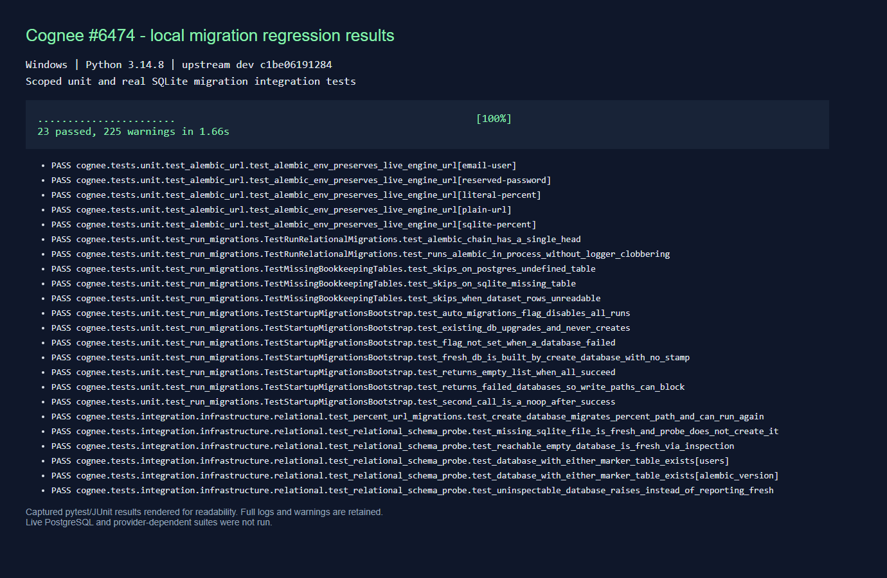

# Cognee issue #6474: local regression evidence

Source commit: [d21f913354e174b7543502a6b5b9119e5c5c7453](https://github.com/DevChiniwala/cognee/commit/d21f913354e174b7543502a6b5b9119e5c5c7453).
Upstream dev base: c1be06191284be8adaba19f980014542d24018cd.

The source commit contains the same tested source and test files. Local validation
ran on Windows with Python 3.14.8 using the repository frozen lockfile and dev group.

- Before the fix: 5 failed, 1 passed. The plain-URL control passes; four URL
  interpolation cases and the real SQLite migration case fail.
- With the fix and existing migration/schema-probe tests: 23 passed, 225 warnings.
- All changed-file pre-commit hooks pass, including Ruff lint and formatting.
- The all-file hook run passes lint, formatting, YAML, whitespace and large-file
  checks. Its EOF failure on Windows's regular-file materialization of the
  unchanged `.claude/skills` symlink reproduces on unmodified dev. The original
  bytes were restored; that unrelated file is absent from the patch.

The screenshot below is a browser capture of the actual local pytest/JUnit
results rendered for readability. It is not a GitHub Actions result.



Command (the same four paths were passed to the captured pytest run):

```text
python -m pytest cognee/tests/unit/test_alembic_url.py cognee/tests/unit/test_run_migrations.py cognee/tests/integration/infrastructure/relational/test_percent_url_migrations.py cognee/tests/integration/infrastructure/relational/test_relational_schema_probe.py -q
```

Live PostgreSQL, the complete unit suite and provider-dependent integration
suites were not run. This evidence does not claim those checks passed.
This standalone evidence branch contains no source changes or workflow files
and is not part of the upstream PR diff.
